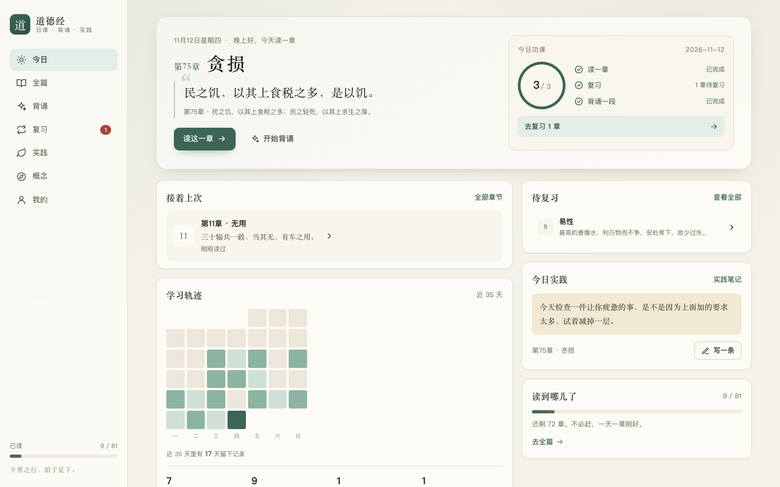
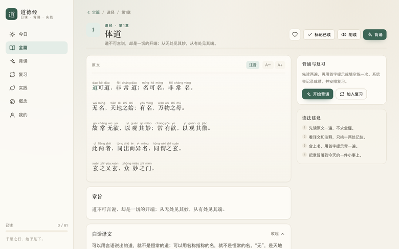
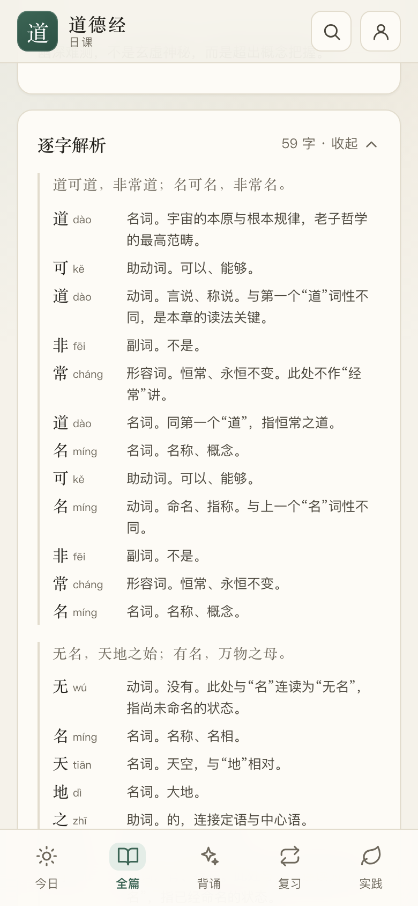

# 道德经日课

一个可直接打开使用的《道德经》学习网站，围绕「学习、理解、背诵、实践」四件事设计。
电脑、平板、手机共用一套界面，安装到桌面后可离线使用。

## 界面

| 今日                                          | 章页（手机）                                 |
| --------------------------------------------- | -------------------------------------------- |
|  |  |

| 全篇                                           | 背诵（手机）                                  |
| ---------------------------------------------- | --------------------------------------------- |
|  |  |

| 注音                                        | 逐字解析（手机）                               |
| ------------------------------------------- | ---------------------------------------------- |
|  |  |

## 功能

- 全篇八十一章，按道经、德经分卷，支持全文检索与按状态筛选。
- 每章提供原文、章旨、白话译文、重点字词注释与一句实践提示。
- 章页读完原文就能就地翻到上一章或下一章，不必滚到页底；桌面端也可以用左右方向键翻章。
- 八十一章全部逐字注音与解析：原文按字标注拼音，并逐字给出词性与释义；通假、旧读与易误读单独标出，可在章页与设置里开关注音。
- 三种背诵方式：首字提示、关键字填空、整章默写，默写自动对照并标出漏字与多字。
- 简化 SM-2 间隔重复：背完自动加入复习队列，按「忘了、模糊、记得、熟练」四档安排下次复习。
- 十四个核心概念（道、德、无为、自然、有无、柔弱、不争、知足、朴、反、水、婴儿、和光同尘、静）可跨章串读。
- 每日一章、今日功课、连续天数与近 35 天学习热力图。
- 践行笔记按章保存，实践页统一回顾。
- 主题（浅色、深色、跟随系统）、正文字号、宋体开关、朗读语速与音色、每日复习目标可调。
- 朗读按逐字注音校正读音：系统 TTS 只吃纯文本，多音字（如「不见可欲」的「见」）会被读错，朗读前换成同音字再送去合成，页面显示不受影响。
- 「不」「一」按变调规则推导读音，数据只存本调：「不」在四声前读 bú（则无不治），「一」作数词修饰名词时变调（共一毂 yì gǔ），作名词指道时仍读 yī。
- 朗读音色分低沉、默认、明亮三档，用音高模拟男女声差异，系统只有一个中文音色时也能听出区别；设备提供多个中文音色时还可另选具体音色并试听。
- 可选的「问道」AI 助手：右下角一个悬浮入口，就当前章节提问，全书八十一章作为材料一并送出；可开启联网搜索回答书外问题，书内书外分开标注；不配置或断网时退回本地检索，阅读与背诵不受影响。配置只存本机，不跟随备份导出，详见 [docs/ai.md](docs/ai.md)。
- 数据仅保存在本机浏览器，支持导出与导入 JSON 备份。
- PWA 离线缓存，支持安装到主屏幕。

## 技术栈

- React 19 + TypeScript + Vite。
- React Router 做前端路由。
- 原生 CSS 变量实现主题与响应式，无 UI 框架依赖。
- localStorage 持久化，`useSyncExternalStore` 订阅状态。
- Vitest + Testing Library 做单元与组件测试。
- vite-plugin-pwa 生成 Service Worker 与 manifest。

## 本地开发

```bash
pnpm install
pnpm dev
```

## 常用命令

```bash
pnpm test          # 运行单元与组件测试
pnpm lint          # oxlint 静态检查
pnpm format        # Prettier 格式化
pnpm build         # 类型检查并构建生产包
pnpm preview       # 预览构建结果
```

## 目录结构

```text
src/
  components/        布局、图标、通用组件、章节卡片
  data/chapters/     八十一章原文、译文、注释、章旨、实践提示
  data/glosses/      八十一章逐字注音与解析，按道经、德经分四卷
  data/concepts.ts   概念索引
  hooks/             数据订阅、外观、朗读、当前时间、页面标题
  lib/               存储、间隔重复、默写比对、检索、统计、日期、朗读读音校正、变调规则、音色选择、AI 请求与引用校验
  pages/             今日、全篇、章节、背诵、复习、实践、概念、设置
  styles/            全局样式与响应式规则
  test/              数据层与页面测试
android/             Capacitor 生成的安卓工程与图标、启动图
scripts/build-apk.sh 一键构建 APK
docs/ai.md          AI 助手的设计与边界
docs/mobile.md      手机安装与更新说明
```

## 内容说明

原文以王弼注《老子道德经》为底本，参校河上公章句，转为简体并按通行分章整理。
译文与注释是为便于理解而写的白话整理，不同注家理解有别，遇到分歧处建议回看原文。
注音依王弼本用字标注，多音字按上下文与章页「重点字词」的说明定读，不作改字；通假、旧读与易误读处单独标注提示。
逐字解析给的是该字在本句中的词性与义项，同一字在不同章可以不同。

## 部署

`pnpm build` 生成的 `dist/` 是纯静态文件，可直接放到任意静态托管。

托管在子路径时用环境变量指定：

```bash
BASE_PATH=/daodejing/ pnpm build
```

`base`、manifest 的 `start_url`、Service Worker 作用域与路由 basename 会一起跟随 `BASE_PATH`。
本站使用 BrowserRouter，托管方需要把未知路径回退到 `index.html`。

## 在手机上使用

三种用法，能力差别很大。

### 一、安卓 APK（推荐）

`release/道德经日课-1.4.2.apk` 可以直接传到安卓手机上安装，不需要应用商店。
安装后是独立应用：图标进桌面、全屏运行、断网可用，数据存在应用沙盒里，不会被浏览器按天清理。

重新打包：

```bash
pnpm apk
```

需要 JDK 21 与 Android SDK（platform 36、build-tools 36）。签名配置在 `android/keystore/`，该目录不入库，请自行备份。
安装与更新细节见 [docs/mobile.md](docs/mobile.md)。

### 二、同一 Wi-Fi 临时试用

电脑上运行：

```bash
pnpm build
pnpm preview:lan
```

终端会打印 `Network: http://<电脑局域网地址>:4173/`，手机连同一个 Wi-Fi，在浏览器里打开这个地址即可。

注意：

- 电脑必须保持开机、服务保持运行，电脑休眠后手机就打不开了。
- 换 Wi-Fi 或电脑换了 IP，地址会变。
- 这是 HTTP 访问，浏览器不把它当作安全上下文，因此 **Service Worker 不会注册，离线不可用，也不能真正安装成 PWA**。阅读、背诵、写笔记与本地保存都正常。
- 想查电脑的局域网地址，macOS 用 `ipconfig getifaddr en0`，Windows 用 `ipconfig`。

### 三、部署后安装成 PWA（iOS 用这个）

把 `dist/` 部署到任意 HTTPS 静态托管（Netlify、Vercel、Cloudflare Pages、GitHub Pages 等），手机访问该 HTTPS 地址后：

- **iOS Safari**：分享按钮 → 添加到主屏幕。
- **Android Chrome**：右上角菜单 → 安装应用 / 添加到主屏幕。

安装后可全屏运行、断网可用。只有 HTTPS（或 localhost）才会被浏览器视为安全上下文，PWA 与离线缓存依赖这一点。

### 两个容易踩的坑

- **数据不跨设备**。手机和电脑各自存各自的 localStorage，互不同步。换设备前在「我的」页面导出备份，再到新设备导入。
- **换域名等于换数据**。localhost、局域网 IP、正式域名在浏览器眼里是三个不同的站点，数据不共享。

## 数据与隐私

所有学习数据只写入当前浏览器的 localStorage，键名为 `daodejing.data.v1`，不会上传服务器。
换设备或清理浏览器数据前，可在「我的」页面导出备份。
浏览器里导出只会发起下载，需要在浏览器的下载列表确认文件；APK 内导出会直接写入系统下载目录的「道德经日课」文件夹（Android 10 及以上），文件不随卸载删除；Android 9 及以下写入应用文件目录，该目录在卸载应用时会一并删除，换机前要先把文件复制出去。
